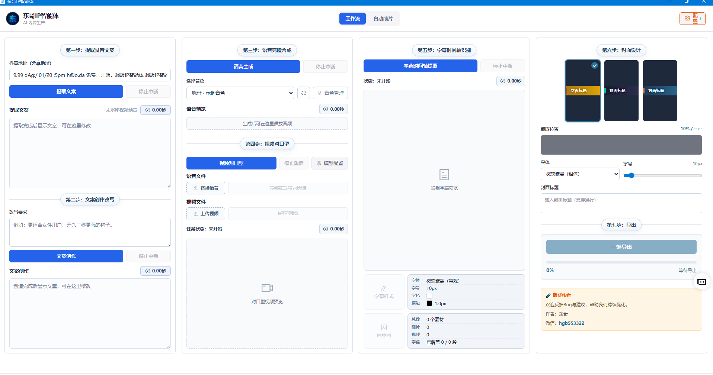
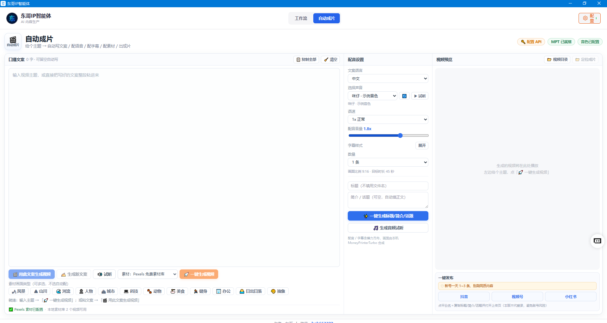
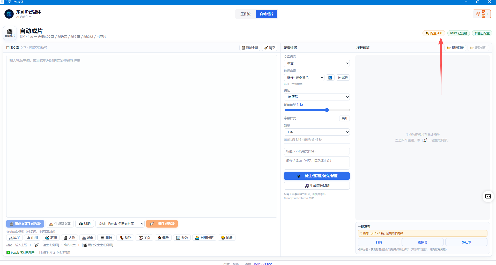
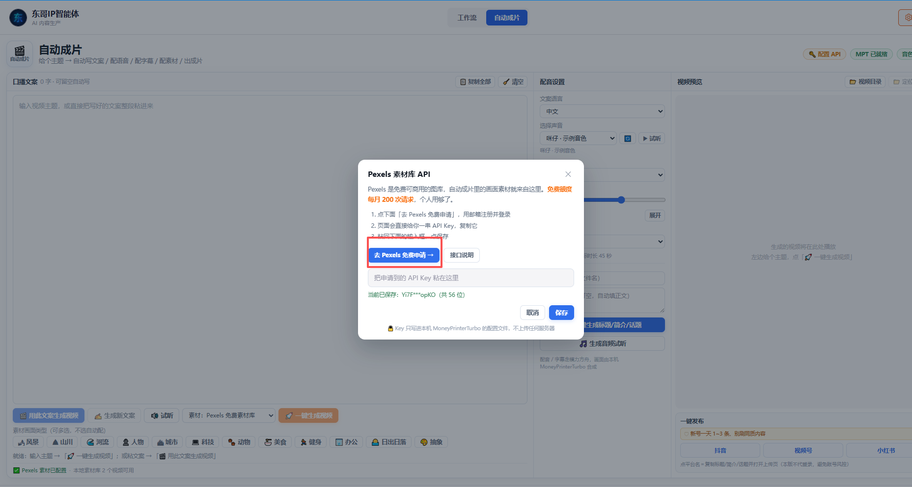
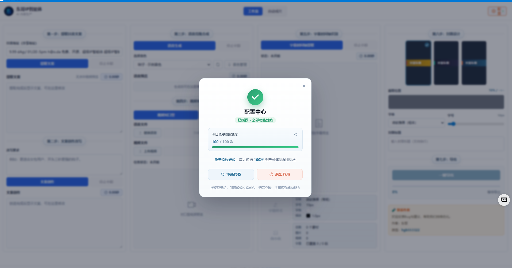

# 东哥IP智能体

> 免费开源 AI 口播视频生产工具 (Electron + Vue3) · 免费一键生成视频

## ⬇️ 下载 Windows 版（普通用户看这条，双击即用）

**直接下这个，约 216 MB，免安装：**

👉 **[DonggeIP-Agent-v1.0.2-win-x64.exe](https://github.com/hear8323/dongge-ip-agent/releases/download/v1.0.2/DonggeIP-Agent-v1.0.2-win-x64.exe)**

> ⚠️ **别点仓库里的「Code → Download ZIP」**——那是**源代码**（二三十 MB），没有打包好的程序，双击跑不起来。要能用的话，请认准上面那个 `.exe`。

- 微信：hgb553322

一个把爆款口播视频流水线装进桌面的 AI 工具。

粘一条抖音链接、或者只给一句话主题，自动完成文案改写、配音、字幕、封面、成片，产出可以直接发布的竖屏视频。



## 一、两种工作模式

### 1. 一键成片（推荐新手）

不想一步步调参数？左上角切到「自动成片」，**只给一句话主题，剩下的全交给 AI**。



为什么推荐新手用它：

- 一句话出片：输入主题，自动走完「写文案 → 配音 → 字幕 → 配素材 → 出成片」全流程，不懂剪辑也能 3 分钟出一条成品视频。
- 12 大主题素材库：风景 / 山海 / 人物 / 城市 / 科技 / 动物 / 美食 / 健身 / 办公 / 出游 / 抽象 等，自动匹配画面和背景音乐，不用自己找素材。
- 你的声音 AI 代读：支持音色克隆，用你自己的声音把文案读出来，不用出镜、不用录音棚。
- 批量生产：一次生成 1~10 条，标题 / 简介 / 话题还能一键自动生成，矩阵号、日更号直接吃饱。
- 一键多平台发布：成品直接发到 抖音 / 视频号 / 小红书，连发布环节都省了。
- 每天 100 次免费：配合免费算力授权，日常起号、试错零成本。

#### 配置素材库 API（首次使用必看）

一键成片的画面素材来自 [Pexels](https://www.pexels.com/)——免费、可商用的图库，首次使用前花 1 分钟配一个免费 API Key：

配置入口：「自动成片」页 → 右上角「**配置 API**」



三步搞定：

1. 点弹窗里的「**去 Pexels 免费申请**」，用邮箱注册并登录 Pexels
2. 复制你的 API Key，粘贴回弹窗输入框
3. 点「**验证**」，通过后「**保存**」



- 免费额度：每月 200 次请求，个人使用足够
- 隐私说明：Key 只用于从 Pexels 拉取画面素材，不会上传你的任何图片 / 视频

### 2. 工作台（分步精修）

想自己控制每一步，就用「工作台」模式，七步流水线：

| 步骤 | 做什么 | 算力消耗 |
| --- | --- | --- |
| 一、提取抖音文案 | 粘贴抖音链接，自动下载无水印视频并把口播内容转成文字 | **免费** |
| 二、文案创作改写 | 按你的要求把原文案改写成自己的脚本 | **免费** |
| 三、语音克隆合成 | 录一段或上传一段音色样本，用你的声音把文案读出来 | **免费** |
| 四、视频对口型 | 把合成的语音和一段人物视频合成口型匹配的视频 | 本地模型部署 |
| 五、字幕时间轴识别 | 自动识别出带时间轴的字幕，可以逐条改字、调字体和描边样式 | **免费** |
| 六、封面设计 | 从视频里抽一帧做底图，填标题、选排版风格，生成封面图 | **免费** |
| 七、导出 | 把字幕烧进画面，叠上画中画，封面作首帧，输出成品 | **免费** |

## 二、免费算力授权

打开程序后，点右上角「配置中心」完成授权登录（新用户注册），即可使用免费算力：



- 每天赠送 **100 次**免费 AI 模型调用
- 授权过期后重新点一次「重新授权」即可

## 三、下载安装（下下来打不开？先看这条）

**九成的「下下来跑不起来」都是下错了文件**——请认准下面的 `.exe`，不要下源码。

1. 打开发布页：[Releases](https://github.com/hear8323/dongge-ip-agent/releases)
2. 在最新版本（v1.0.2）的 **Assets** 里，点 `DonggeIP-Agent-v1.0.2-win-x64.exe`（约 216 MB）下载
3. 双击 exe 即可运行，无需安装

| 你看到的文件 | 能不能直接用 | 说明 |
| --- | --- | --- |
| `DonggeIP-Agent-v1.0.2-win-x64.exe` | ✅ 能 | Windows 便携版，双击即用 |
| `Source code (zip)` / `Source code (tar.gz)` | ❌ 不能 | 这是源代码，需要 `npm install` + 打包才能跑，普通用户别下 |

> ⚠️ 仓库主页绿色的「Code」按钮下面的「Download ZIP」也是**源码**，不是程序，请勿下载。

Windows 首次运行如果被杀毒软件拦截，把程序所在文件夹加入白名单即可。

其他平台可参照源码自行构建（Electron + Vue 3，`npm install` 后 `npm run build`）。

## 四、AI 对口型（数字人功能）

### 方式1: Kling AI（推荐，免费每日166积分）

无需租卡，直接在App内配置即可使用：

1. 点击右上角【模型配置】
2. 选择模式：「🎬 Kling AI（免费，每日166积分）」
3. 填入 API Key（从 https://app.klingai.com/ 获取）
4. 填入 Session ID（浏览器F12 → Application → Local Storage → session_id）
5. 点击「保存配置」，重启App
6. 代理服务自动启动在 `http://127.0.0.1:8899`

### 方式2: 自建 duix 服务（免费，需GPU）

- 第 1 步：**本地有显卡的电脑** 或 **租有显卡的云主机**（推荐显存 **6G+**）
- 第 2 步：安装 Docker
- 第 3 步：创建 `docker-compose.yml` 文件并写入内容

  ```yaml
  networks:
      ai_network:
          driver: bridge
  services:
      duix-gen-video:
          image: wupeiqi/duix
          container_name: duix-gen-video
          restart: always
          runtime: nvidia
          privileged: true
          volumes:
              - ./data:/code/data
          environment:
              - PYTORCH_CUDA_ALLOC_CONF=max_split_size_mb:512
          deploy:
              resources:
                  reservations:
                      devices:
                          - capabilities: [gpu]
          shm_size: '6g'
          ports:
              - '8383:8383'
          networks:
              - ai_network
  ```

- 第 4 步：启动对口型服务

  ```
  docker compose up
  ```

获取本机算力地址，例如 `http://127.0.0.1:8383`，填入到对口型的模型配置中。

## 五、常见问题

**一直提示要先去配置中心授权**

- 模力方舟的登录状态过期了，重新点一次配置中心的授权即可。访问令牌本身很久才失效，但登录态失效会影响上传音色样本。

**Windows 提示找不到 ffmpeg.exe**

- 杀毒软件把它拦了。把程序所在的文件夹加进杀毒软件的白名单或排除项，然后重开程序。

**macOS 连不上局域网里的对口型服务**

- macOS 15 开始，访问局域网需要单独授权。首次连接时按弹窗允许，或者去「系统设置 → 隐私与安全性 → 本地网络」把本程序打开。填 `127.0.0.1` 连本机服务不受这个限制。

**对口型提交后报服务器忙碌**

- 算力服务一次只能跑一个任务，等当前任务结束再提交。

**抖音链接提取失败**

- 先确认链接还能正常打开。抖音的接口时常调整，如果链接没问题但一直失败，可以到 Issues 反馈。

## 许可说明

程序内置的 `ffmpeg-static` 采用 GPL-3.0 许可，分发时需遵守相应条款。`src/assets/fonts/` 下的字体请自行确认商用授权。
